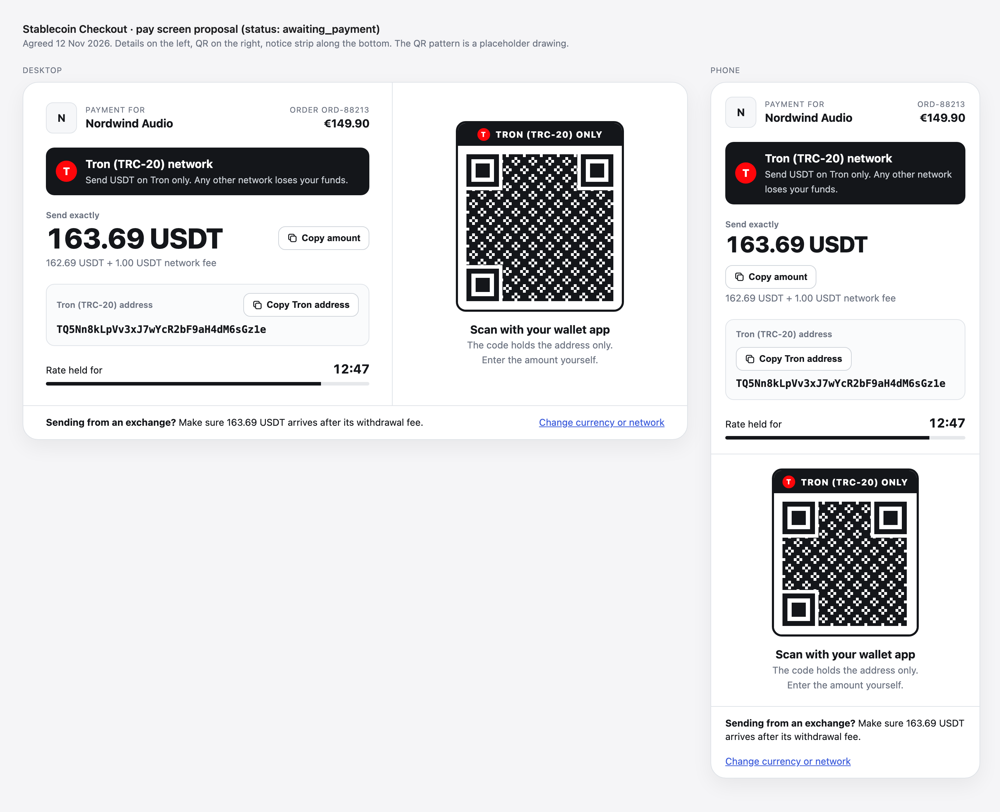
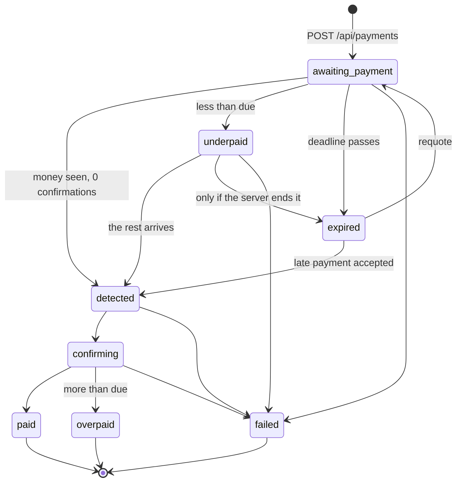
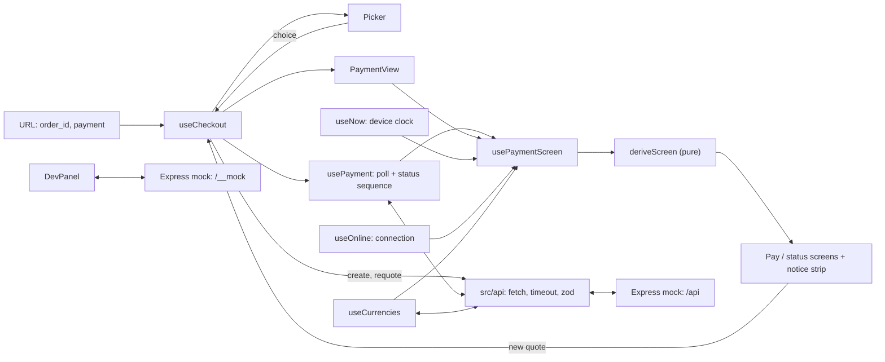
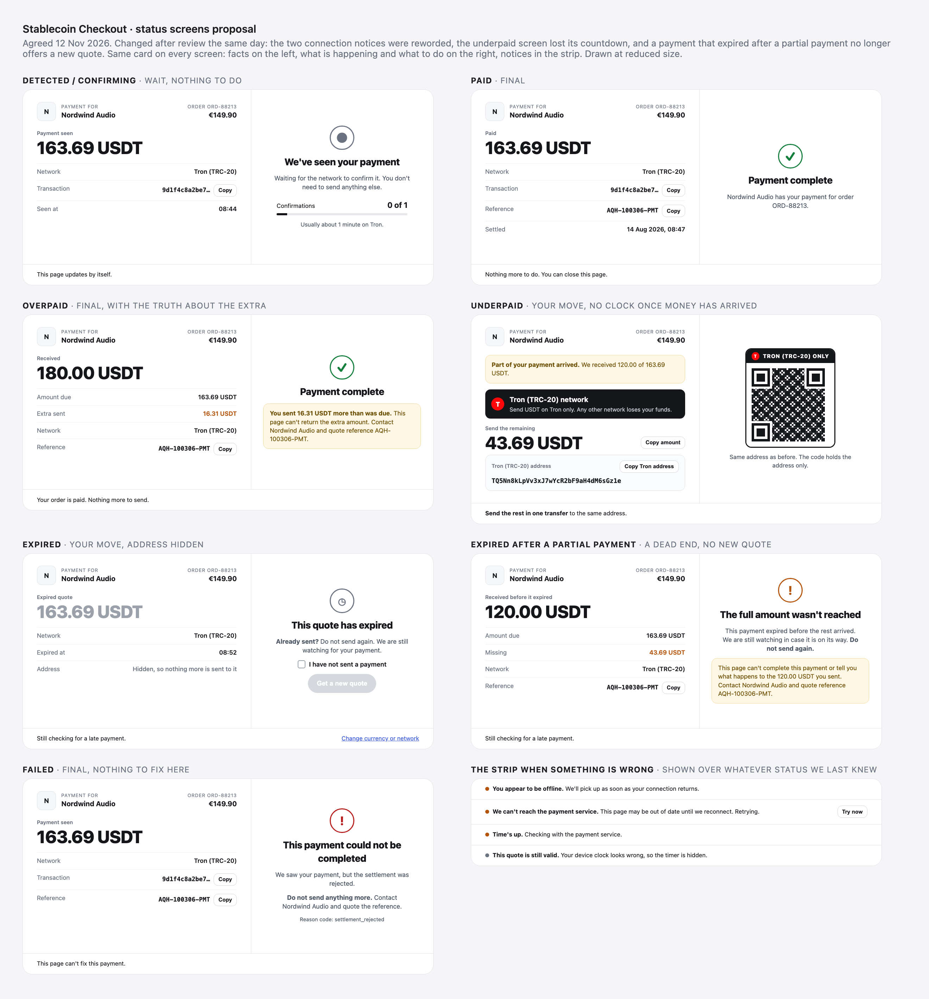
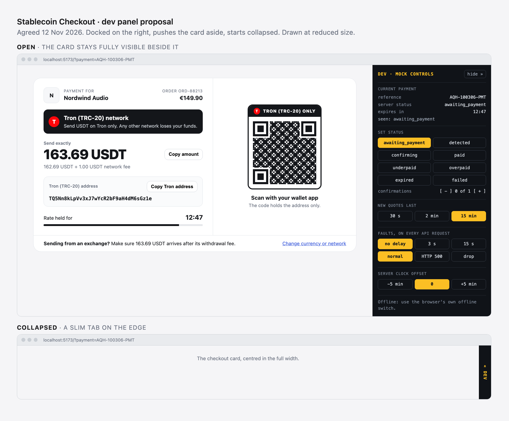

# Stablecoin Checkout: design doc

**Status:** written before the build on 12 Nov 2026, revised the same day after two reviews, and revised again after the build so that it describes what exists. Where the build departed from the first design, the text says so. The decisions with a real trade-off are in [`adr/`](adr/).

## 1. What this is

A hosted payment page. A shopper who chose "Pay with crypto" picks a currency and a network, gets a quote (an exact amount, an address, a QR code and a countdown), sends the money from their own wallet, and the page follows the payment until the server reports a final result.

The page cannot see the blockchain and does not control the outcome. It reports what the server says. That shapes most of the design: the page holds very little state of its own, and every screen is derived from the server's last answer.

**What I optimised for, in this order:**

1. The network is impossible to miss. The page cannot make a wrong-network send impossible, because the QR carries no network ([ADR 0004](adr/0004-qr-holds-address-only.md)), so the labelling has to do that work.
2. The page never expires or hides a payment that is on its way.
3. Every screen tells the truth, including the uncomfortable ones (overpaid, failed).
4. No digit of an amount is lost or invented.

**Not in scope:** auth, real wallets or chains, a merchant dashboard, translations, pixel-perfect design, dark mode. Browser end-to-end tests are a follow-up (section 10).

**What would make this a failure even if it works:** a quote that expires while money is on its way, an address shown without its network, a promise the API does not back (a refund), float maths on money, or code I cannot explain a week later.

## 2. The flow

The page has three screens inside one card. The card keeps the same shape throughout: the payment's facts on the left, what is happening and what to do on the right, and a strip along the bottom for notices.

| Screen | When | Agreed design |
|---|---|---|
| Picker | No payment exists yet | [`design/picker-proposal.png`](design/picker-proposal.png) |
| Pay | `awaiting_payment`, `underpaid` | [`design/pay-screen-proposal.png`](design/pay-screen-proposal.png) |
| Status | Every other status | [`design/status-screens-proposal.png`](design/status-screens-proposal.png) |



The drawings are the designs I agreed before the build, and they are kept as agreed. The build differs from them in six small ways. Two changed while building: the pay screen has no bar under the countdown (section 5), and the dev panel has no live readout (section 8). Four changed when I went over the finished screens: the picker has no line about the clock under it, the pay screen has no hint about exchange withdrawal fees, the expired screen has no address row, and the network menu shows the chosen network's name alone (section 11).

**Choose first, then quote.** The page opens on the picker with nothing selected. No payment exists and no clock runs. Only when the shopper presses "Continue with USDT on Tron" does the page call `POST /api/payments` and show an address.

I chose this over creating a quote on landing with a default currency, for two reasons. A default puts an address on screen for a network the shopper never chose, which is the mistake the brief warns about. And a clock that starts before the shopper has decided adds pressure to the one choice that can lose their money.

The API forces part of this. `POST /api/payments/:reference/requote` returns 409 unless the quote has already expired, so a change of network while a quote is live cannot be a requote. It has to be a new `POST /api/payments`, which creates a new payment with a new reference and leaves the old address live.

**Changing the choice:**

- **While the quote is live** (`awaiting_payment` only): "Change currency or network" asks for confirmation first, because a payment sent to the old address after the change would not be tracked on this page. If the shopper confirms they have not sent anything, the page returns to the picker and the next choice creates a new payment. The confirmation cannot rule out a transfer started on another device a moment earlier. I accept that, because the alternative is to make a shopper who picked the wrong network wait for the quote to expire before they can correct it.
- **After the quote expired with no money seen:** the same link returns to the picker, and the next choice calls requote on the same reference. Requote takes a currency and a network, so it can change both. No payment is abandoned, and the page keeps polling the payment while the picker is open, in case a late payment arrives.
- **Once any money was seen** (`underpaid`, `detected` and later): there is no way to change. The remainder has to go to the same address on the same network.
- **If the server ends a partial payment** (`expired` straight after `underpaid`): there is no change and no new quote. The page sends the shopper to the merchant ([ADR 0003](adr/0003-partial-and-late-payments.md)).

**What the picker can show.** The API returns the merchant name and the order amount only inside a payment. On the picker no payment exists, so it shows the order reference and the choices, and the merchant name and fiat amount appear from the pay screen onwards. I did not add an order endpoint to the mock to fill this in; see section 9.

**Refresh.** After a payment is created, its reference goes in the URL (`?payment=AQH-100306-PMT`). On load, a reference in the URL makes the page fetch that payment and resume on the right screen. The page replaces the current history entry instead of adding one, so Back does not walk through earlier payments. This departs from the brief, which lists persistence as out of scope; the reasoning is in [ADR 0005](adr/0005-resume-from-url-reference.md).

## 3. The payment lifecycle state model

### 3.1 Eight statuses

`GET /api/payments/:reference` defines eight statuses: `awaiting_payment`, `detected`, `confirming`, `paid`, `underpaid`, `overpaid`, `expired`, `failed`.

The brief's lifecycle diagram shows four and says "there are six more". The API section defines four more, not six, so I built for eight and listed this as an open question (section 9).

### 3.2 State chart



These are the transitions I expect from a real server. **The page does not enforce them.** It renders whatever status the server reports, in any order, because the server is the only party that knows what happened on chain. The dev panel can set any status at any time, and the page has to cope with every order.

There is one exception, and it only ever hides something. Once money was seen for a quote, a later `awaiting_payment` does not bring the address back (3.4).

### 3.3 Three groups: what the shopper can do

The brief asks which states the shopper can still fix. I sort the statuses by what the shopper can do, and each group looks different.

| Group | Statuses | What the shopper sees | Action |
|---|---|---|---|
| **Your move** | `awaiting_payment`, `underpaid`, `expired` | Something to do, stated once | One main action |
| **Wait** | `detected`, `confirming` | Progress, and "nothing more to send" | None. The address and QR are gone so nobody sends twice |
| **Final** | `paid`, `overpaid`, `failed` | The result | None |

Fixable problems are `underpaid` (send the rest) and `expired` when no money was seen (get a new quote). They carry one clear action each. The problems the shopper cannot fix are `failed`, the extra money in `overpaid`, and a quote that expired after a partial payment. Those screens have no button at all, so nothing looks like a fix that is not one. They give the shopper the reference, the amounts and the merchant's name to take away.

### 3.4 From status to screen

The screen is the output of one pure function. Its inputs are the server's status, the sequence of statuses seen (3.5), the device clock and the connection state.

| Server status | Condition | Screen | Address and QR | Countdown | Poll |
|---|---|---|---|---|---|
| `awaiting_payment` | time left | Pay | shown | shown | 3 s |
| `awaiting_payment` | countdown at zero, check in flight | Pay, "Time's up, checking" | hidden | at zero | at once |
| `awaiting_payment` | server answered "still live" after zero, and within the last 10 s | Pay, "quote still valid" | shown | hidden | 3 s |
| `awaiting_payment` | countdown at zero, check failed | Pay, "can't confirm" | hidden | hidden | backing off |
| `awaiting_payment` | money was already seen for this quote | "We're checking" | hidden | none | 3 s |
| `underpaid` | | Pay, remaining amount | shown | none | 3 s |
| `detected`, `confirming` | | Waiting | hidden | none | 3 s |
| `paid` | | Complete | hidden | none | off |
| `overpaid` | | Complete, with a notice about the extra | hidden | none | off |
| `expired` | straight after a status that carried money, skipping any status the page does not know | Expired after money was seen, a dead end | hidden | none | 15 s |
| `expired` | sequence started from a reload | Expired, cautious wording | hidden | none | 15 s |
| `expired` | otherwise | Expired | hidden | none | 15 s |
| `failed` | money seen, not seen, or unknown | Failed, in three wordings | hidden | none | off |
| anything else | | "We're checking" | hidden | none | 3 s |

Connection trouble is not a row in this table. It is a notice in the strip, laid over whichever row applies (section 7).

**A status that goes backwards.** If `awaiting_payment` follows `detected`, `confirming` or `underpaid` on the same quote, the page cannot tell which of two things happened. Either the answer is stale and the money is there, or the transaction was dropped and the shopper does need to pay again. Showing the address would be right in the second case and would invite a double payment in the first. So the page shows "We're checking your payment. Don't send again." and keeps polling, and only a new quote brings an address back. In the dropped-transaction case the shopper waits for the quote to expire and then gets a new one: `expired` straight after `awaiting_payment` is the plain expired screen, where a new quote sits behind the "I have not sent a payment" tick box. A delay can be recovered from, and a double payment cannot.

A review argued that this last step should be a dead end too, because the page did see money for that quote. I kept the new quote so that a dropped transaction can be recovered on this page. It is a known limit, and making "money was seen" permanent for a quote is a follow-up (section 10).

### 3.5 The status sequence

Some screens depend on what happened before. `expired` straight after `underpaid` must not offer a new quote, because the shopper already sent part of the money and the API does not say what happens to it. The `expired` response itself carries only `expired_at`.

So the page keeps the sequence of statuses it has seen for a payment, each with the fields that came with it (amount received, amount outstanding, transaction hash). It is stored beside the payment in the query cache and appended in the one function where a server response becomes cached data. Polls and requotes both pass through that function, so there is no effect to keep in sync and no second store.

Its rules:

- A repeated status updates the last entry instead of adding one.
- "For this quote" means the entries since the last creation or requote. A partial payment on an earlier quote does not change the wording for a later one.
- The sequence records whether it started at creation or from a reload. After a reload the page cannot know whether money arrived earlier, so `expired` and `failed` use cautious wording: "If you sent any funds for this payment, do not get a new quote. Contact Nordwind Audio." If a resumed sequence later sees money, that evidence wins over the cautious wording.
- `failed` carries only a reason and `expired` only a time. Any amount on those screens comes from the sequence, never from `total_due`.

### 3.6 Unknown statuses

A status the page does not know is not a validation error. The schema accepts any status string, and an unknown one maps to a safe screen: "We're checking your payment. Don't send again." Polling continues. The screen also shows the payment reference with a copy button and says to contact the merchant if it does not change, so a status that never resolves still leaves the shopper a way forward.

In code, the known statuses are one discriminated union and the screen function switches over it exhaustively. Adding a ninth status fails to compile until every place handles it.

### 3.7 When polling stops

Polling stops on `paid`, `overpaid` and `failed`. After one of those, or after the server says it does not know the payment, the page sends no request of any kind: not from the timer, the tab returning, a reconnect or "Try now".

It does **not** stop on `expired`, which the brief might count as terminal. A shopper who sent in the last seconds can be told "expired" before the server sees their money. If the page stopped there, it would invite a second payment while the first is in flight. So `expired` keeps polling, more slowly, until the shopper gets a new quote, and the screen says "Already sent? Do not send again. We are still watching for your payment." The trade-off is in [ADR 0003](adr/0003-partial-and-late-payments.md).

## 4. Component structure and data flow



Data moves one way. A server response is validated, stored in the query cache with the status sequence, turned into a screen by a pure function, and rendered. Shopper actions go back out through `useCheckout` as two writes, create and requote, whose responses re-enter by the same path.

### 4.1 Layers

| Folder | Holds | Rule |
|---|---|---|
| `src/api` | Request functions, timeouts, zod schemas | The only code that talks to the server or validates a response's shape |
| `src/domain` | Status groups, `deriveScreen`, the status sequence, countdown maths, the amount guard | Pure functions, no React, no I/O |
| `src/hooks` | `useCheckout`, `usePayment`, `usePaymentScreen`, `useCurrencies`, `useNow`, `useOnline`, and small ones for the picker's selection, copying and the dialog | Own all behaviour and timing |
| `src/components` | The card, picker, pay screen, status screens, strip | Render only. A component may keep view state that nothing else reads, such as a ticked box or an open dialog |
| `src/dev` | The dev panel | The only code that knows the mock exists |
| `mock/` | The Express app, fixtures, control endpoints | |

### 4.2 State

| State | Lives in | Why |
|---|---|---|
| Payment, currencies, status sequence | TanStack Query cache | It is server data, or derived from it at the boundary |
| Selected currency and network | React state in `usePickerChoice` | It belongs to the picker and nothing else reads it |
| Whether the picker is open for a new quote, a write in progress and its error | React state in `useCheckout` | It belongs to one screen tree and nothing outside React reads it |
| Payment reference, order id | The URL | So a refresh resumes |
| A ticked box, an open dialog, the open dev panel | React state in that component | View state that nothing else reads |
| Which screen to show, connection notice, time left | Not stored | Derived on every render |

There is no state library and no state machine library. A client state machine would model transitions the page does not own: the server drives every one of them, and the page only maps the latest answer to a screen.

### 4.3 Requests

Reads retry themselves. Writes ask the shopper. The API has no idempotency key, so a retried create makes a second payment. That is harmless to the shopper, who never saw its address, but creating payments silently would hide a failing server.

| Request | Slow response | Failure | Retry |
|---|---|---|---|
| `GET /api/currencies` | Loading state, give up at 10 s | Full-card error | Automatic, two more tries with backoff, then "Try again". Until the list arrives, it also asks again when the tab regains focus or the connection returns |
| `POST /api/payments` | Progress on the button, "still working" after 4 s, give up at 10 s | Error beside the button, choices intact | Manual only |
| `GET /api/payments/:ref` | Give up at 10 s, counts as a failed poll | Last status stays, notice after two failures in a row | The next poll is the retry |
| `POST …/requote` | As for create | Error on the expired screen | Manual only, then re-read the payment in case it went through |

Further rules:

- One create is in flight at a time, and the menus are disabled while it is.
- A 4xx with a problem body is an answer, not an outage. It is not retried.
- A requote that returns 409 `quote-not-expired` makes the page re-read the payment and show what the server says.
- A response that fails validation counts as a failed request.
- An answer must be about what was asked. A payment with another reference, another order or another pair than the request named is rejected in the same way as a malformed one. The whole-branch review found this missing; section 9 states the one case it cannot cover.
- Every API request bypasses the HTTP cache (`cache: 'no-store'`), and the mock sends `Cache-Control: no-store`. A cached `awaiting_payment` must never stand in for a fresh one.

### 4.4 Polling

Polling uses TanStack Query's own interval on one query per payment reference. The interval is a function of the last result: 3 s while active, 15 s on `expired`, off on final statuses, and doubling up to 30 s after consecutive failures.

- The library's built-in retries are off for this query, because the next poll is the retry.
- A hidden tab pauses polling. One poll fires as the tab returns.
- There is one query per payment reference, and every trigger goes through it: the interval, the tab returning, the check at zero and "Try now". A trigger that fires during a request joins that request instead of starting another.
- Starting a requote waits for the poll in flight to be cancelled before it sends, and cancels again just before it writes the answer. A poll that was running, or one that started during the requote, cannot overwrite the fresh quote with an older "expired" answer.
- Unmounting, or switching to another payment, aborts the request in flight and clears the timer.

The guarantee that two polls never overlap comes from the library: a query has at most one request in flight, and an interval tick that lands during a request joins it. I rely on that and prove it with tests that fire every trigger against a response slower than the interval. The alternative, a hand-written loop, is weighed in [ADR 0002](adr/0002-polling-with-tanstack-query-interval.md).

### 4.5 The API as the brief gives it

Four endpoints. Every amount is a decimal string.

| Endpoint | Request body | Response |
|---|---|---|
| `GET /api/currencies` | | `{ currencies: [{ code, name, decimals, networks: [{ id, name, network_fee, required_confirmations, avg_confirmation_seconds }] }] }` |
| `POST /api/payments` | `{ order_id, currency, network }` | 201 with a payment |
| `GET /api/payments/:reference` | | The payment, its current status, and that status's fields |
| `POST /api/payments/:reference/requote` | `{ currency, network }` | 201 with the same reference, a new quote and `awaiting_payment`, or a 409 |

A payment, as returned by create:

```json
{
  "payment_reference": "AQH-100306-PMT",
  "order_id": "ORD-88213",
  "status": "awaiting_payment",
  "merchant": { "name": "Nordwind Audio", "logo_url": null },
  "order": { "currency": "EUR", "amount": "149.90" },
  "quote": {
    "crypto_currency": "USDT",
    "network": "tron",
    "network_name": "Tron (TRC-20)",
    "exchange_rate": "0.9214",
    "crypto_amount": "162.69",
    "network_fee": "1.00",
    "total_due": "163.69",
    "crypto_address": "TQ5Nn8kLpVv3xJ7wYcR2bF9aH4dM6sGz1e",
    "required_confirmations": 1,
    "expires_at": "2026-08-14T08:52:10.842Z"
  }
}
```

The fields each status adds:

| Status | Fields |
|---|---|
| `awaiting_payment` | none |
| `detected` | `confirmations`, `required_confirmations`, `amount_received`, `tx_hash`, `detected_at` |
| `confirming` | `confirmations`, `required_confirmations`, `amount_received`, `tx_hash` |
| `paid` | `confirmations`, `required_confirmations`, `amount_received`, `tx_hash`, `settled_at` |
| `underpaid` | `amount_received`, `amount_outstanding`, `crypto_address`, `tx_hash` |
| `overpaid` | `amount_received`, `amount_excess`, `tx_hash`, `settled_at` |
| `expired` | `expired_at` |
| `failed` | `reason` |

The six currency and network pairs in the catalogue:

| Currency | Decimals | Network (`id`) | `network_fee` | Confirmations | Usual seconds |
|---|---|---|---|---|---|
| USDT | 6 | Tron (TRC-20) (`tron`) | `1.00` | 1 | 60 |
| USDT | 6 | Ethereum (ERC-20) (`ethereum`) | `4.50` | 3 | 180 |
| USDC | 6 | Ethereum (ERC-20) (`ethereum`) | `4.50` | 3 | 180 |
| USDC | 6 | Polygon (`polygon`) | `0.10` | 6 | 30 |
| USDC | 6 | Solana (`solana`) | `0.01` | 1 | 15 |
| ETH | 18 | Ethereum (`ethereum`) | `3.20` | 3 | 180 |

Errors are `application/problem+json` with `type`, `title`, `status` and `detail`. The brief defines one: requote returns 409 with type `https://developers.triple-a.io/errors/quote-not-expired`.

## 5. How the countdown stays correct

**It is never a counter.** The page does not subtract one each second. Every tick recomputes `expires_at` minus the device clock. A browser throttles or suspends timers in a hidden tab, so a counter would fall behind by however many ticks it missed. A recomputed value cannot drift: the first tick after the tab returns shows the right time, whether the tab was hidden for two minutes or the laptop slept for an hour. The time is rounded up to the next second, so `0:00` appears only when no time is left.

**No bar under the time.** The agreed drawing has a progress bar under the countdown. A bar needs the quote's full lifetime, and the API gives only its deadline, so the build shows the time alone.

**The tab returning is an event.** When the tab becomes visible again, the page recomputes at once and polls at once, so the shopper never acts on a stale screen.

**The countdown is information, not authority.** It uses the device clock, which can be wrong. Only the server's status can end a quote:

| What happens | What the page does |
|---|---|
| Countdown reaches zero | Hides the address and QR, shows "Time's up, checking", polls at once |
| Server says `expired` | Shows the expired screen and the new-quote action |
| Server says the quote is still live | Brings the address back, hides the timer, shows "this quote is still valid". The device clock is known to be wrong, so the page stops showing a number it cannot trust |
| No timer, and the server has not answered for 10 s | Hides the address until a fresh answer arrives. This covers the tab returning from the background and polls that start failing |
| The check fails | Keeps the address hidden and says it cannot confirm |
| Server says `expired` while the countdown still shows time | Shows the expired screen. The server wins |
| Server says `underpaid`, `detected` or later | The countdown is gone for good |

Without a timer the page has no local deadline to rely on, which is why the untimed state depends on a recent answer from the server.

The clock errors behave differently, and I accept all three:

- **Device clock ahead:** the countdown ends early, the check finds the quote still live, and the shopper can still pay. Without the "still live" rule, a shopper whose clock runs far ahead could never pay.
- **Device clock behind:** the countdown shows more time than the server allows. The page corrects at the first poll after the server expires the quote. This is the real cost of using the device clock, and the late-payment polling on `expired` softens it.
- **Device clock behind, during an outage:** the address stays visible until the device's countdown reaches zero, and the real deadline can pass first. This needs both failures at once, and I accept it rather than hide a valid quote from everyone whose connection drops for a minute.

I considered correcting the clock from the server's `Date` header and chose not to. The reasoning is in [ADR 0001](adr/0001-server-decides-expiry.md).

**Any money stops the clock.** The countdown exists only on `awaiting_payment`. Once the server reports money, whether the full amount or part of it, there is no countdown and nothing on this page can expire the payment. A shopper who sent part can always send the rest. The cost is that the rate stays open for the remainder; the reasoning, and how I changed my mind on it, is in [ADR 0003](adr/0003-partial-and-late-payments.md).

## 6. How I handle decimal precision

The rule is that no digit of an amount is lost or invented between the API and the shopper's wallet. USDT has 6 decimal places and ETH has 18, and a JavaScript `number` holds only about 15 to 17 significant digits.

A real example from the mock's ETH quote, checked in Node:

| | Value |
|---|---|
| Server sends | `0.054229071702481731` |
| Through `Number` | `0.05422907170248173`, the last digit is gone |

**What the page does:**

- **Amounts are strings end to end.** The API sends decimal strings. They get their own string type, created only where a response is validated, so passing one to ordinary maths is a compile error.
- **No maths on money.** The page shows `total_due`, `amount_outstanding` and `amount_excess` as the server sends them. It never adds the fee, subtracts what was received, or rounds.
- **Validation at the boundary.** A response is rejected if an amount arrives as a JSON number or is malformed. A JSON number has already been through a float by the time the page sees it.
- **A decimal-places check before any amount to send is shown.** A crypto amount with more decimal places than its currency's `decimals` allows is rejected. This check needs the currency list, so it runs where the payment and the list meet.
- **Crypto is shown exactly as sent.** Dot decimal, no thousands separators, never rounded or shortened, including all eighteen ETH places. The copy button copies that exact string with no unit.
- **Only fiat follows the locale.** The order amount goes to the browser's number formatter as a string, which current browsers format exactly, so a German shopper sees `149,90 €`. A test asserts that a long decimal string comes through the formatter unchanged.
- **No decimal library.** A library would earn its place if the page did arithmetic. It does not.
- **No floats in the mock either.** Its amounts are literal strings in a hand-written table.

I show crypto exactly as sent, not in the shopper's locale, because that number gets retyped or pasted into a wallet. A wallet that expects a dot may reject `163,69`, or read `1.234,56` wrongly. A locale-formatted crypto amount is the one way this page could cause a wrong amount.

**Where `decimals` is used.** `GET /api/currencies` returns each currency's `decimals`. The page uses it for the decimal-places check above and nowhere else. After a reload the currency list has to be fetched again. Until it arrives and the amount has passed the check, the pay screen shows a loading state with no amount, address or QR. The quote's currency and network must also be in the currency list, under the same network name; if they are not, the pay screen shows the same problem state it shows for an amount that fails the check. Screens that only report a status do not wait for it, so a payment in flight is never hidden behind the currency list. It would also be needed to build wallet payment links, which the page does not do; see [ADR 0004](adr/0004-qr-holds-address-only.md).

## 7. How I show failure states



### 7.1 Four rules for wording

1. **Say only what the API says.** No promised refunds, and no outcomes the response does not state.
2. **A dead end gives the shopper something to take away:** the reference with a copy button, the amounts, the transaction hash, and the merchant's name as who to contact.
3. **A fixable screen has one main action. A dead end has none.**
4. **The page never tells anyone to send again** unless the status calls for it.

### 7.2 The screens

| Status | Headline | What it says | Action |
|---|---|---|---|
| `underpaid` | Part of your payment arrived | What was received, the exact amount still to send, same address and network. No countdown | Send the rest |
| `expired` | This quote has expired | "Already sent? Do not send again. We are still watching for your payment." The address is hidden | "Get a new quote", enabled only after ticking "I have not sent a payment" |
| `expired` after `underpaid` | The full amount wasn't reached | What was received and what was missing. "Do not send again. This page can't complete this payment or tell you what happens to the 120.00 USDT you sent. Contact Nordwind Audio and quote reference AQH-100306-PMT." | None |
| `overpaid` | Payment complete | "You sent 16.31 USDT more than was due. This page can't return the extra amount. Contact Nordwind Audio and quote reference AQH-100306-PMT." | None |
| `failed` | This payment could not be completed | The reason in plain words, the server's reason code in small print, "do not send anything more", contact the merchant | None |
| unknown | We're checking your payment | "Don't send again. If this doesn't change, contact Nordwind Audio and quote reference AQH-100306-PMT." | None |

The tick box belongs to the plain `expired` screen and its cautious reload variant. The partial-payment screen has no tick box, because a shopper who paid part cannot truthfully tick "I have not sent a payment". It is a dead end, with no button and no link to change currency.

Notes on three of them:

- **`overpaid`** is shown as a success with a clear notice, not as plain green and not as an error. The response has a settlement time, so "complete" is true. It says nothing about a refund, so neither does the page.
- **`failed`** is a dead end on purpose. I do not know what a reason such as `settlement_rejected` means for a second attempt, and a retry could leave more money stuck. If the sequence shows money was seen, the screen says so, "We saw your payment, but it could not be completed", and shows the amount beside it.
- **`detected`** says "We've seen your payment on the network", not "received" or "complete". Zero confirmations is not settled.

### 7.3 Connection trouble is a layer, not a status

If the server is down or the shopper is offline, the last status the page knew stays on screen with a notice in the strip. A connection problem never shows as `failed` or `expired`.

| Notice | When |
|---|---|
| "You appear to be offline. We'll pick up as soon as your connection returns." | The browser reports no connection, which is a hint and not proof. Polling pauses and resumes when it returns |
| "We can't reach the payment service. This page may be out of date until we reconnect. Retrying." with "Try now" | Everything else: 500s, timeouts, invalid responses, network errors while the browser says it is online |

Neither notice says the payment is safe or unaffected. A failed request tells the page nothing about the payment.

While the connection is down, the address and QR **stay visible** on `underpaid`, and on `awaiting_payment` while the quote still has time left. The quote is valid until its deadline whether or not this page can reach the server, and the shopper's wallet is usually on another device. Once the countdown reaches zero they are hidden, because the page can no longer confirm the quote is live.

### 7.4 Shopper safety on the pay screen

- **The network is named in six places:** on the picker's button before any address appears ("Continue with USDT on Tron"), in the pay screen's heading, in the banner under it, in the address label, on the copy button ("Copy Tron address"), and on the frame around the QR.
- **The QR holds the address only.** An Ethereum address and a Polygon address look identical, so the QR itself carries no network information, and a wallet that scans it learns nothing about the network. That is a real limit of this design. The frame around the QR names the network, and the step that stands in for a machine-readable network is the picker's button, which the shopper presses with the network named on it immediately before the address appears.
- **Nothing is preselected in the picker,** and changing the currency clears the network, so the network is always chosen on purpose.

## 8. The mock and the dev panel

The mock is a small Express app mounted inside the dev server, so `npm run dev` starts one process on one port. `npm run preview` mounts it too. It keeps payments in memory, so restarting the server forgets them.

**What it does:**

- `POST /api/payments` creates a payment with a new reference every time.
- Quotes come from a hand-written table, one row per currency and network, each with its own rate, fee and address.
- `GET /api/payments/:reference` returns the whole payment (merchant, order, quote) plus the status fields.
- `awaiting_payment` becomes `expired` when the deadline passes. A payment that has received money never expires by itself.
- Requote succeeds only from `expired`. Anything else gets the 409.

**How reviewers drive it.** The control lives in the mock, not in the app's requests. The dev panel calls control endpoints under `/__mock`, and the app's own request code never knows a mock exists. The same endpoints work with `curl`.



| Control | Options |
|---|---|
| Set status | Eight buttons, usable in any order, plus a confirmations stepper |
| Quote lifetime | 30 s, 2 min, 15 min, applied to new quotes |
| Faults, on every API request | Delay of 3 s or 15 s; HTTP 500; dropped connection. The control endpoints are exempt |
| Server clock offset | −5 min, 0, +5 min, to see the clock-difference handling without changing the system clock |

The offline notice is tested with the browser's own offline switch.

The panel is docked on the right and pushes the card aside instead of covering it, so a reviewer can change a status and watch the page react. It starts collapsed.

What the build changed from the drawing:

- **No live readout.** The drawing shows the mock's status and time left, refreshed every two seconds. I cut it before the panel was built, because it needed its own polling loop to show what the checkout page beside it already shows. The panel shows the open payment's reference and the statuses the page has seen, taken from the page's own data. It reads the mock's settings once each time it opens, so its buttons match the mock after a reload.
- **A failed command shows nothing in the panel.** The checkout page beside it already reports a payment the server does not know.
- **It is in every build.** The mock is too. A real deployment would have neither.

After `paid`, `overpaid` or `failed` the page has stopped asking the server (3.7), so a status set from the panel after that shows only after a reload.

## 9. Assumptions and open questions

These are places where the brief is silent or does not fit together. Each is a question I would ask the backend team.

| Topic | What the brief says | What I assumed |
|---|---|---|
| Number of statuses | "There are six more states" beyond the four in the diagram | The API defines four more. I built for eight in total |
| Fee unit | The catalogue lists a `network_fee` of `3.20` for ETH; the one example quote, for USDT on Tron, adds the fee in the crypto's own units | The catalogue is served exactly as given. I read its fees as USD. Each quote carries the fee converted into the crypto's units, one to one for USDT and USDC. The brief shows no ETH quote, so I defined one: `3.20` USD at 3,000 USD per ETH is a fee of `0.001066666666666667` ETH. This is an assumption, not something the brief states |
| Order details before a payment | Merchant and order amount come only inside a payment | The picker shows the order reference only. I did not invent an order endpoint |
| What `GET` returns | "Returns the payment with an updated status, plus the fields below" | The whole payment, plus the status fields |
| Repeated `POST /api/payments` | Not stated | A new payment with a new reference each time |
| Deadline on `underpaid` | The response has no deadline field | There is none. Once any money has arrived, the mock does not expire the payment and the page shows no countdown. If a server reports `expired` after `underpaid` anyway, the page treats it as a dead end |
| Funds from a partial payment that expired | Not stated. Requote returns the "same body as `POST /api/payments`", with no word on earlier funds | The page does not guess. It offers no new quote and sends the shopper to the merchant |
| Money arriving after expiry | No status for it | The server may move `expired` to `detected`, so the page keeps watching |
| Is `expired` terminal? | "Stop polling on terminal states", without listing them | Only `paid`, `overpaid` and `failed` are terminal. `expired` can return to `awaiting_payment` through requote |
| Money sent to an earlier quote after a requote | Not stated | The page cannot attribute it. It offers a new quote only when it has seen no money for the current quote, and it shows whatever the server reports |
| An unknown reference | Not stated | The mock returns 404 in the same problem format |
| An answer about another payment or pair | Not stated | The page checks a create or requote answer against the shopper's choice, and every answer against the reference it asked for. A later poll cannot be checked against the choice, because the page keeps no record of it across a reload, so the network the server states is named beside the address in every case |
| `failed` reasons | One example, `settlement_rejected` | Known codes get plain words. Any other code gets generic wording with the code in small print |

## 10. Follow-ups

Things I left out on purpose, and what each would need:

- **Wallet payment links in the QR.** A standard link would prefill the amount in the shopper's wallet. Token links need each token's contract address, which the API does not return. ([ADR 0004](adr/0004-qr-holds-address-only.md))
- **Merchant name and amount on the picker.** Needs an endpoint that returns the order before a payment exists.
- **Fees in the order's currency.** The picker shows catalogue fees in USD while the order is in EUR.
- **A server time source for the countdown.** A time field in the response body would remove the device-clock error. ([ADR 0001](adr/0001-server-decides-expiry.md))
- **Full resume after a reload.** The status sequence restarts on reload, so the page forgets that money was seen. Keeping the sequence in session storage would restore the exact wording, and even a single stored "money was seen" flag per payment would close the gap on the same device. ([ADR 0005](adr/0005-resume-from-url-reference.md))
- **Making "money was seen" permanent for a quote.** Today a quote that goes `detected`, back to `awaiting_payment`, then `expired` offers a new quote behind the tick box. Treating it as a dead end would be stricter, at the cost of the dropped-transaction path.
- **A new quote after a partial payment.** Needs the backend to define what happens to funds already sent.
- **Checking every poll against the shopper's choice.** Needs the choice to survive a reload (section 9).
- **A bar under the countdown.** Needs the quote's lifetime or start time in the response.
- **A live readout and error messages in the dev panel.**
- **Browser end-to-end tests.**
- **A mock script that advances a payment by itself.** The dev panel's status buttons already reach every state.

## 11. Details set by default

These were not discussed one by one. I set them while writing this document, and each is easy to change.

- **Timings:** poll every 3 s, 15 s on `expired`, backoff doubling to 30 s, request timeout 10 s, "still working" hint at 4 s, connection notice after two failed polls in a row.
- **Order id:** read from `?order_id=` in the URL, falling back to `ORD-88213` so the page runs with no setup.
- **Exchange rate:** shown under the amount, exactly as sent ("1 USDT = 0.9214 EUR").
- **Going back from a live quote:** the browser's modal dialog. "Have you already sent a payment? Only change if you have not sent anything." The safe answer, "Stay on this payment", has focus when it opens, and focus returns to the link when it closes.
- **`expired` tick box:** on the plain and cautious `expired` screens it enables both "Get a new quote" and "Change currency or network".
- **`expired` straight after `detected` or `confirming`:** this should not happen on a real server, but the dev panel can force it. It gets the same dead end as after a partial payment, with the headline "This payment expired".
- **Picker menus:** the browser's own, with the fee and usual time in each option's text. Once a network is chosen its menu shows the name alone, so it is not cut off, and the fee and usual time are on the line under the menus. A currency with one network (ETH) has it filled in.
- **Payment not found on resume:** back to the picker with a notice.
- **Copy buttons:** show "Copied" for two seconds, announced to screen readers.
- **Dates and times:** formatted for the shopper's locale and time zone.
- **Accessibility:** status changes are announced, the countdown is not read out every second, focus moves to the new screen's heading, and colour is never the only signal.
- **Mock control endpoints:** `GET /__mock/state`, `POST /__mock/payments/:reference/status`, `POST /__mock/settings`.
- **Tools:** Vite, React and TypeScript in strict mode; Tailwind; TanStack Query; zod; `qrcode.react` for the QR; Express for the mock; Vitest and React Testing Library; ESLint and Prettier; npm.
- **Browsers:** current Chrome, Safari, Firefox and Edge.

Checked during the build: a dropped connection from the mock mounted in the dev server arrives as no HTTP response at all, not as a 500. Through `npm run dev`, `curl` printed status `000` and exited with code 52 ("Empty reply from server"). Node's `fetch` rejects on it in the mock's tests. In a browser, with the mock set to drop, the page kept the last status, showed the notice after two failed polls, sent exactly one request for "Try now", and recovered by itself once the fault was switched off.

Checked during the build: TanStack Query never starts a second request for a payment while one is in flight. The polling test holds a request open and fires every trigger at it: ten seconds of interval ticks, a manual check twice, the tab hidden and shown, and the browser going offline and back. The seven fetches those triggers made all joined the open request, and no more than one request was ever in flight.

Checked during the build: TypeScript's typings do not accept the amount string in the number formatter without a cast. TypeScript 6.0 types `Intl.NumberFormat.format` as taking a number, a bigint or a `${number}` literal type, and a validated decimal string is a branded `string`, so it is rejected. `formatFiat` casts the method's signature and nothing else, and passes the string unchanged. Node formats it exactly, and a test checks that `1234567890123456.78` comes through with every digit.

## 12. One thing I would defend

**The page never declares a quote expired by itself.**

The brief says: "When it reaches zero, show an expired state and a way to get a new quote." I do something different. When the countdown reaches zero, the page hides the address, says "Time's up, checking", and asks the server. Only the server's `expired` shows the expired screen. If the server says the quote is still live, the address comes back and the timer goes away.

The countdown runs on the shopper's device clock, and that clock can be wrong in either direction. If the page trusted it, a shopper whose clock runs ahead would be told "expired" on a live quote and sent to requote, which the API refuses with a 409. Worse, in the seconds around the deadline the page would be showing "expired, get a new quote" to someone whose money is already on its way. The brief's own last line is that a simple page is better than one that expires the quote while the shopper's money is on the way. Asking the server first costs one request and, in the normal case, a fraction of a second of "checking". I think that is the right price for never being wrong about it.
